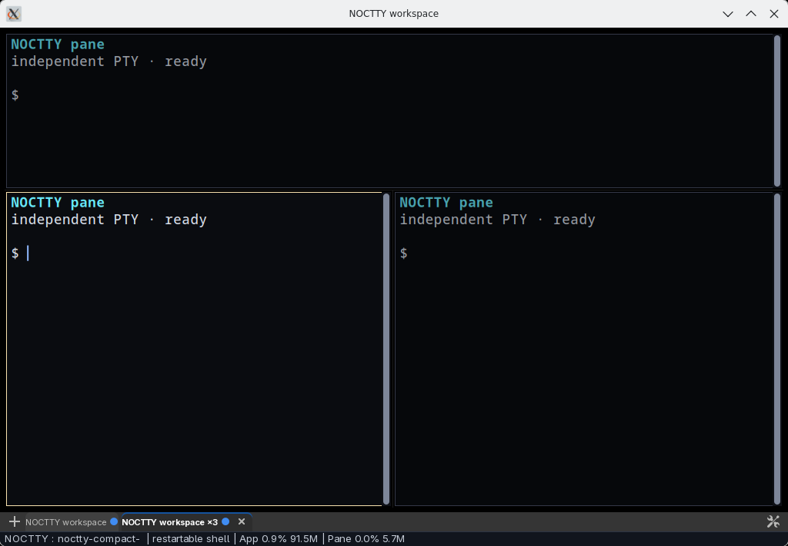
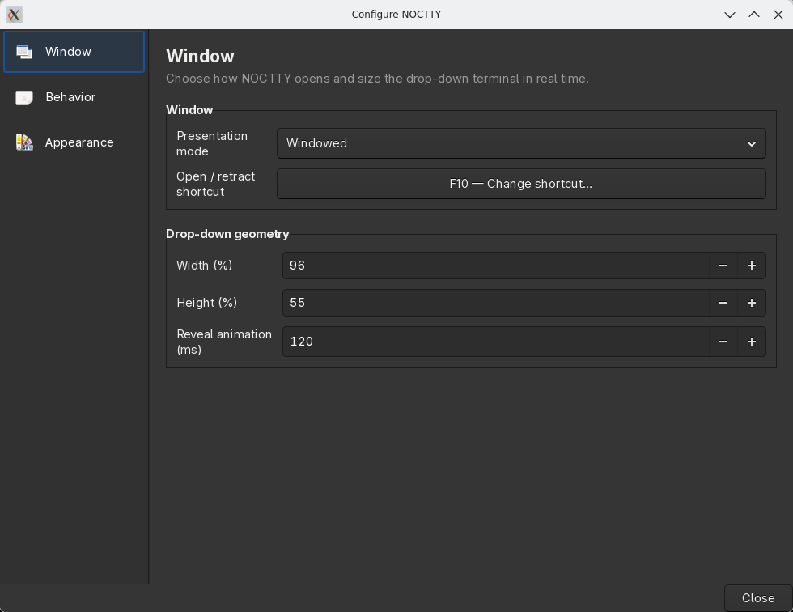
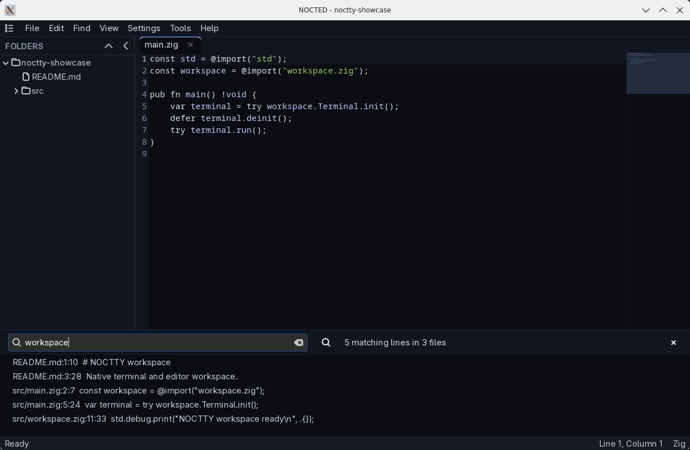

# NOCTTY

NOCTTY is a native terminal workspace focused first on Linux desktops: KDE
Plasma, Noctalia-compatible Wayland compositors, Wayland, and X11. An
experimental native Windows host now provides a first Win32/ConPTY terminal
tranche using the same Zig VT core. NOCTTY is built for the workflow that
usually turns into many heavy VS Code/MrCode/Electron windows: agent sessions,
shells, logs, quick edits, and project navigation.

NoctEd is the companion standalone editor. It is intentionally smaller than a
full IDE: open a project, edit files, search, save safely, and get back to the
terminal.

NOCTTY and NoctEd use Zig with native GTK/Win32 bindings. The runtime does
**not** use Electron, Node.js, Bun, React, a browser UI runtime, telemetry,
update pings, crash uploaders, or remote feature flags.

## Status

Current public-readiness status: **early source alpha; public announcement not yet approved**.

A separate experimental Windows terminal alpha is now available for testing;
it is not yet Windows feature parity or physically qualified.

The local 0.1.0 behavior scope has substantial proof coverage on the author's
Linux/KDE-style environment, but the project is not yet a broad public release.
The next goal is to make NOCTTY/NoctEd reliable enough for daily use while
keeping the public claims small and honest.

The NCT-112 hidden/visible stability harness passes its short Debug/`ReleaseSafe`
Wayland/X11 shakedown. The default authenticated 24-hour Wayland plus 24-hour
X11 run still needs elapsed time and is not claimed complete.

Supported first:

- Linux desktop
- KDE Plasma Wayland/X11
- Noctalia-compatible Wayland sessions
- native terminal workspace use
- standalone NoctEd quick editing

Experimental:

- x86_64 Windows 10 1809+/Windows 11 Win32/ConPTY terminal workspace with bounded native tabs and recursive splits

Not claimed yet:

- Windows feature parity or physically qualified Windows terminal/editor and
  installer daily-driver support
- macOS support
- VS Code/Zed/Sublime parity
- universal terminal compatibility
- multi-day production stability
- authenticated agent compatibility across every coding CLI
- signed/public packages

See [Known limitations](docs/KNOWN_LIMITATIONS.md), the [no-surprise network check](docs/NO_SURPRISE_NETWORK.md), the [code map](docs/CODE_MAP.md), the [Konsole resilience review](docs/KONSOLE_RESILIENCE_REVIEW.md),
the [terminal peer research](docs/TERMINAL_PEER_RESEARCH.md), the [agent fairness qualification](docs/TERMINAL_AGENT_FAIRNESS_QUALIFICATION.md), the [mapped presentation qualification](docs/NATIVE_GRID_PRESENTATION_QUALIFICATION.md), the [full-stack mapped qualification](docs/NATIVE_GRID_FULL_STACK_QUALIFICATION.md), the [hidden/visible stability qualification](docs/NATIVE_GRID_STABILITY_QUALIFICATION.md), the [authenticated Codex qualification](docs/AUTHENTICATED_AGENT_QUALIFICATION.md), the [installed tmux/Zellij continuity qualification](docs/INSTALLED_CONTINUITY_QUALIFICATION.md), the [NoctEd native endurance qualification](docs/NOCTED_NATIVE_ENDURANCE_QUALIFICATION.md), and the detailed historical status in [Technical status](docs/TECHNICAL_STATUS.md).

### Local-agent resource research

The [small-model teams and memory-tier research](../../tools/ZNAP/SMALL_MODEL_TEAMS_AND_MEMORY_TIERS.md)
and [retained cache/host evidence](../../tools/ZNAP/research/memory-tier-verification-2026-09-13.json)
apply to terminals hosting coding agents: share qualified serving weights rather
than launching a model copy per tab, but keep project histories and permissions
separate. A task abort must not terminate an unrelated shared inference server.
Preserve terminal responsiveness and existing fairness/output bounds while
serializing resource-heavy model or artifact work through its owning runtime.
The observed zram/zswap setup consumes physical RAM; it is not extra model capacity.
Page-cache hints do not prove endpoint readiness, and terminal/PTY qualification
does not prove model task quality. These are integration guidelines, not a new
NOCTTY inference engine, agent scheduler or change to default behavior.

## Build and run

Linux requirements:

- Zig 0.16.x (the build intentionally rejects other minor versions)
- GTK 3 development files discoverable through `pkg-config`
- GtkSourceView 4 development files discoverable through `pkg-config`
- system `gtk-layer-shell` at runtime for Wayland dropdown placement;
  dependency bundles and dogfood installs copy the host package's library into
  a launcher-owned private runtime after provenance/license checks
- VTE 2.91 development files only for `zig build check`, smoke binaries, or the
  optional legacy/fallback binary; not for the production build

Install the [distribution prerequisites](docs/INSTALL.md#prerequisites), then
run from the repository root in your desktop session:

```sh
zig build -j1
./zig-out/bin/noctty --native-grid-windowed
```

This builds both production applications without running the maintainer matrix.
Launch the editor with `./zig-out/bin/nocted --open README.md`. No OVERZEER install,
agent CLI account, packaging receipt, or physical qualification is needed.
For the dropdown instead, use `zig build run`.
Use `noctty --help` or `nocted --help` for command-line options. To work with a
saved editor project, use **File > New Project** or open an existing `.npr` file;
`--project` expects a project file, not a directory.

Useful launch variants:

```sh
zig build run -- --native-grid-windowed
zig build run -- --native-grid-zen
zig build run -- --native-grid-two-pane
zig build run-nocted -- --open src/nocted/main.zig
```

Optional legacy/fallback build:

```sh
zig build vte-fallback
./zig-out/bin/noctty-vte --native-host
```

Native x86_64 Windows cross-build (no GTK dependency):

```sh
zig build -Dtarget=x86_64-windows-gnu -Doptimize=ReleaseFast
./scripts/package_windows.sh dist/noctty-windows-x86_64-alpha.zip
```

See [Windows alpha](docs/WINDOWS.md) for the current feature and proof boundary.

## Install/package locally

Local install:

```sh
zig build -j1 -Doptimize=ReleaseSafe --prefix "$HOME/.local"
```

Reproducible install-tree tarball:

```sh
./scripts/package_tarball.sh /tmp/noctty-local.tar.gz
```

Same-architecture dependency bundle:

```sh
./scripts/package_bundle.sh /tmp/noctty-linux-bundle.tar.gz
```

ZTASH dogfood packages for the configured OVERZEER receivers:

```sh
./scripts/package_ztash.sh
./scripts/package_ztash_smoke.sh
```

This replaces the ignored `dist/ztash/` output with target-bound
`noctty-<version>-linux-x86_64.tar.gz` and
`noctty-<version>-windows-x86_64.zip` archives, `SHA256SUMS`, and
`ztash-release.json`. The package script builds both targets, runs the Linux
headless `--package-smoke`, and removes repository Zig caches and temporary
staging on exit. Windows runtime smoke remains a receiver/Wine qualification
boundary unless `NOCTTY_ZTASH_WINE_SMOKE=1` is set.

Preview the authenticated fleet deployment only after selecting an immutable
artifact-host base URL:

```sh
../../OVERZEER/tools/overzeer-ztash-deploy.sh preview \
  --release-dir dist/ztash \
  --base-url https://downloads.example.invalid/noctty
```

Remote mutation requires `--apply` and `OVERZEER_CONFIRM=DEPLOY`; private
DDJARIN/CHOPPER credentials are resolved by OVERZEER and never belong in this
repository or its package metadata.


See [Install and package](docs/INSTALL.md) for runtime requirements and package
contents. The dependency bundle is not a public redistribution promise until
independent license/redistribution review and release receipts are complete.

## Screenshots

Current 2026-09-06 alpha captures use an active-window crop inside the
repository's disposable private X11/KWin boundary; no author desktop or active
session appears in the images. They demonstrate current rendering, not physical
input or release approval. Recapture safely with
`./scripts/capture_alpha_screenshots.sh`; it self-isolates by default.

**Terminal workspace**


**Tabs and recursive splits**



**Native settings**



**NoctEd project editor**


**NoctEd project-wide search**



## What works today

The qualified Linux NOCTTY host provides:

- undecorated, horizontally centered dropdown mode with responsive percentage
  sizing, native decorated windowed mode, and zen/fullscreen mode; every mode
  watches monitor geometry, work area, scale, and reveal events, then reflows
  or clamps itself after a display-resolution change
- native terminal tabs and recursive splits with configurable transparent or
  theme-colored pixel gaps and optional 70%-by-default inactive-pane dimming
- guarded broadcast input across selected panes or the active tab, with explicit enable confirmation and immediate disable
- compact tab chrome inspired by Yakuake/Konsole workflows
- bottom active-pane bar with NOCTTY-wide and selected-terminal-tree CPU/memory usage
- per-pane scrollbars with wheel, track-click, thumb-drag, and Shift+Page/Home/End keyboard navigation; alternate-screen applications receive DEC mouse wheel input, retained emitted rows, or xterm-compatible cursor-key wheel fallback as appropriate, plus scrollback search, copy/paste, resize, Unicode/ANSI handling, and safe `http`/`https`/`mailto` links through a default-browser action or link context menu
- terminal content exposed through native ATK text semantics for Linux screen readers
- configurable launch profiles for shells, commands, SSH, tmux, and Zellij paths
- retained installed tmux 3.7b/Zellij 0.44.3 detach, NOCTTY relaunch, reattach, and preserved-content proof on Plasma Wayland/X11
- retained authenticated Codex 0.144.6 exact-response proof through the production PTY/VT/GTK/Cairo path on Plasma Wayland/X11
- hot-session workspace recovery plus mapped Wayland/X11 desktop-link and Recent Workspaces activation, with explicit shell-restart, tmux/Zellij-attach, or registered-agent-resume choices
- validated last-known-good settings/theme fallback, exact damaged-state retention, and a native startup recovery notice instead of a blocked terminal
- deterministic pre-state single-instance ownership for the dropdown, cold-start and Show/Toggle activation-token handoff without PTY inheritance, plus explicit separate New Workspace and Dolphin **Open NOCTTY Here** launches
- continuity badges distinguishing restartable shells, live sessions, and agent resumes
- opt-in password-protected encrypted screen-history export
- native settings, command palette, terminal search, Quick Note, shortcut card, and Project Workspace surfaces with keyboard-accessible controls, assistive status/error feedback, and work-area-bounded narrow-window scrolling
- optional tray/status notifier integration
- native themes plus Ghostty, Xresources, Alacritty, and Noctalia JSON imports;
  each tab can select its own theme, and that theme maps ANSI colors used by TUI
  applications as well as terminal background, caret, gap, and workspace roles
- opt-in end-to-end encrypted sharing of the active terminal to one paired
  NOCTTY device, with a native remote preview and separately approved,
  connection-scoped input control, assistive form/status semantics, and a
  work-area-bounded preview

The experimental Windows host provides a native Win32/GDI window, ConPTY,
the shared Zig VT/parser, Unicode and control-key input, live resize, ANSI/true
color, scrollback, clipboard paste, text selection, DEC mouse reporting,
bounded tabs and recursive splits, native settings, saved-layout restore,
launch profiles, local logs/minidumps, and paired session sharing/receiving.
The Windows package also contains a separate native NoctEd editor with
persistent 8–32 point font controls, menu/keyboard zoom, and `Ctrl+wheel`
document zoom. Its reproducible per-user NSIS installer provides reversible
shortcuts/Open-With registration and an operator-owned signing hook. Physical
Windows 10/11 qualification and full Linux workspace parity remain open. See
[Windows alpha](docs/WINDOWS.md).

NoctEd provides on Linux:

- standalone `nocted` binary/process
- project tree with persistent show/hide controls and one-click parent-directory navigation
- a clean Untitled buffer on first launch, plus file tabs with 28-logical-pixel close targets and explicit interaction states
- UTF-8 editing through GtkSourceView with direct vendored Tree-sitter highlighting and GtkSourceView fallback
- document find and project Find in Files
- quick open
- reversible folding
- minimap
- persistent 8–32 point GUI font controls under **Settings > Interface Font Size...**, independent from View-menu, keyboard, and `Ctrl+wheel` code-text zoom
- recent projects
- atomic save/Save As behavior
- atomic hot-exit recovery for dirty saved and untitled tabs
- Save/Discard/Cancel protection when closing individual dirty tabs
- visible keyboard focus, descriptive search placeholders, and bounded 28-logical-pixel transient controls
- sustained Debug/`ReleaseSafe` Wayland/X11 search, ranking, monitor, project-lifecycle, render, memory, and teardown qualification

## Paired session sharing

Session sharing mirrors presentation state, not a PTY or process. The machine
running the shell remains authoritative; closing it ends the remote view.
Open **Session Sharing…** from the Linux workspace menu. On one device choose
the other device's alias and reachable endpoint, then **Listen for pairing**;
the listener does not infer a routed return address. On the other device,
choose **Discover on LAN** to fill the
announced endpoint, review it, and choose **Connect to pairing listener**. If LAN discovery is
unavailable, enter the listener's reachable hostname or IP directly. Compare
and explicitly confirm the six-digit code on both devices. The endpoint may be
a LAN address, IPv4/IPv6 address, DNS name, or a
Tailscale/WireGuard/ZeroTier-style VPN name or address.

Select the saved peer and choose **Share current pane**, **Share current tab**,
or **Share entire session** on the host, then **Receive from selected device** on the
viewer. A pane share stays pinned to that pane and ends when it closes. A tab
share follows every pane in the tab that was active when sharing started. An
entire-session share follows every tab and pane in workspace order, including
tabs and panes opened, closed, reordered, renamed, or moved while connected.
The receiver's **Shared tab** selector chooses the reconstructed remote tab;
the preview renders all of that tab's panes from the host split tree and ratio
state. **Shared pane** changes keyboard focus within the layout, and clicking a
pane does the same. Selected and host-active panes remain visibly distinct.
The form, actions, and status use native accessibility names/roles, but the
Cairo remote-terminal canvas does not yet expose its cell text through an ATK
text interface; screen-reader use of remote terminal content is not qualified.
Each pane keeps an independent bounded sequence and checkpoint. Receivers also
retain the latest 64 host scrollback rows per pane; the preview's mouse wheel
navigates that bounded history while new rows preserve the scrolled view.
`Ctrl+Shift+V` and `Shift+Insert` paste only after an explicit user action,
including bracketed-paste framing when the remote application requests it.
Remote pastes are capped at 64 KiB so one clipboard action cannot monopolize
the native UI; partial failures attempt to close bracketed-paste mode and stay
visible in the sharing status.
Keep the same TCP port used during pairing reachable on the host. Viewing is
the default. A control request and host grant apply only to the selected pane
and current connection; changing panes requires a separate grant. Grants end
on revoke, disconnect, pane closure, resynchronization, or reconnect. After a
link closes or fails, **Reconnect securely** performs a new authenticated
handshake with the saved paired key and starts view-only. A stopped or failed
host/viewer can also be explicitly closed without restarting NOCTTY.
**Revoke paired device** asks for confirmation, persists locally, closes a
matching active share, and removes the revoked record from the actionable
selector. If paired-device persistence fails, the in-memory change is identified
as current-run-only and **Retry saving devices** remains available.

There is no relay, account service, NAT traversal, port forwarding, or subnet
scan. Pairing listeners send bounded, opt-in LAN multicast/broadcast
announcements containing only a temporary instance identifier, alias, port,
protocol version, and capability bits. Announcements are unauthenticated hints;
trust begins only after both devices confirm the same pairing code. Discovery
runs only while the user asks for it in the Session Sharing dialog. Closing the
dialog stops discovery, pairing, hosting, and receiving because NOCTTY does not
yet have a separate persistent sharing indicator. Direct endpoints remain the
reliable path across routed VPNs.

After the encrypted transport starts, both sides require matching workspace,
dynamic-pane, tab-hierarchy, split-layout, share-scope, resynchronization,
keepalive, and per-pane-control capabilities. Sequence gaps discard an affected
pane's partial snapshot and request a fresh bounded checkpoint; they are not
repaired by replaying an unbounded PTY byte stream.
The host also probes an otherwise idle viewer and closes a link that does not
answer.

## What NOCTTY is not

NOCTTY is not trying to be a full IDE or a VS Code clone. It is a small native
workspace for terminal-heavy development.

NoctEd is not trying to be VS Code, Zed, or Sublime Text. It should become a
trustworthy companion editor for quick project edits, not a plugin platform.

WIZP is the separate experimental rich-editor/WebView line. Ideas may transfer
from WIZP, but NOCTTY should stay native and avoid inheriting WIZP's webview,
Bun, or VS Code-parity stack.

## Common controls

```text
Configured global shortcut (F10 default) show / hide
Ctrl+Shift+P           command palette
Ctrl+Shift+F           find in scrollback
Ctrl+Shift+N           quick note
Ctrl+Shift+Z           zoom / restore pane
Ctrl+Shift+G           Smart Tab filter
Ctrl+Shift+Y           tag selected panes
Ctrl+Shift+K           shortcut card
Ctrl+Tab               next visible pane
Ctrl+Shift+Tab         next tab / Smart Tab
Alt+Arrow              directional pane focus
Alt+wheel              previous / next pane
Ctrl+Alt+wheel         previous / next tab
Ctrl+wheel             pane font up / down
Shift+PageUp/PageDown terminal history page up / down
Shift+Home/End        oldest / live terminal output
Ctrl+C                 interrupt active pane
Ctrl+D                 close active pane
Ctrl+click link         open in the default browser
Right-click link        open in browser / copy address
Right-click pane        terminal actions / Open NoctEd Here
```

NoctEd:

```text
Ctrl+S                 save
Ctrl+F                 find in file
Ctrl+Shift+F           find in project
Ctrl+PageUp/PageDown   previous / next file
Ctrl+wheel             zoom editor text in / out
Ctrl+W                 close file
Ctrl+Shift+[/]         fold / unfold region
```

More interaction detail: [Compact UX](docs/COMPACT_UX.md).

## Verification

Linux contributor gate (also requires VTE development files):

```sh
zig build check -j1 --summary all
```

Windows compile gate:

```sh
zig build check -Dtarget=x86_64-windows-gnu -Doptimize=ReleaseSafe
```

See [Contributing](CONTRIBUTING.md#before-opening-a-change) for choosing a
focused gate and the extra dependencies for graphical checks. Verification is
not a prerequisite for launching the production build.

<details>
<summary>Maintainer qualification commands and historical evidence</summary>

Retained Linux Debug evidence reports `19/19` steps and `421/421` tests;
the experimental Windows `ReleaseSafe` cross-compile also has a retained pass.
These are historical receipts, not a claim that an arbitrary current checkout
or machine has passed. The retained isolation receipt covers private
X11/Wayland state and no inherited active display.

Bounded public-source-alpha gate (see the prerequisite list in Contributing):

```sh
./scripts/public_alpha_verify.sh
```

Dogfood `ReleaseFast` install with private crash/debug logs, atomic duration
receipts, and the private GTK Layer Shell runtime needed for an undecorated
Wayland dropdown:

```sh
./scripts/install_dogfood.sh
./scripts/dogfood_status.sh
./scripts/dogfood_runtime_status.sh --list-candidates
```

Current retained evidence includes seven operator-confirmed installed NOCTTY
sessions totaling 167.107 counted hours. This closes the minimum session-count
baseline, not NCT-125's required clean current-build workflow recapture or the
remaining four-pane, lifecycle, editor-coverage, and multi-OMP checks.

The display-backed post-upgrade lane is operator-initiated inside a disposable
Plasma VM/session and performs no package refresh, telemetry, or upload:

```sh
NOCTTY_DEDICATED_DISPLAY=1 ./scripts/plasma_wayland_post_upgrade.sh --full
```

See [Dogfood install and logging](docs/DOGFOOD_LOGGING.md).

Main maintainer gate:

```sh
./scripts/verify.sh
```

A single-job maintainer run on the source available at that time completed on
2026-08-03, including the Debug/`ReleaseSafe` terminal, renderer, PTY, NoctEd
core/worker, project-index, package, release-contract, and truth-check lanes,
followed by `verify_cleanup scratch=true cache=true install=true artifacts=true`.

Display-backed smoke gate (disposable dedicated VM/container compositor only,
never the active desktop):

```sh
NOCTTY_DEDICATED_DISPLAY=1 ./scripts/native_release_smoke.sh
```

Focused X11 and Wayland regressions use the serialized, timeout-bounded
`scripts/run_isolated_x11.sh` and `scripts/run_isolated_wayland.sh` wrappers;
the maintainer gate fails closed if their required isolation tools are missing.

Opt-in focused qualification lanes exist for terminal compatibility, renderer
behavior, PTY lifecycle, NoctEd worker/index/search behavior, and native UI
lifecycle. These are engineering evidence, not blanket public guarantees. The
full detailed receipt history lives in [Technical status](docs/TECHNICAL_STATUS.md)
and the active finish list lives in [BACKLOG.md](BACKLOG.md).

</details>

## Public alpha finish line

Before publishing as a Lichforge public alpha, the project should have:

- a clean human-readable README (this file)
- current screenshots or short GIFs
- a contributor code map for navigating the large native code paths
- a minimal install/build path tested from a clean checkout
- daily-driver dogfood notes from real NOCTTY/NoctEd sessions
- known limitations documented without marketing overclaim
- package/signing/redistribution status clearly separated from source release
- a retained no-surprise network/telemetry source scan

See [Public alpha plan](docs/PUBLIC_ALPHA_PLAN.md), [go/no-go sheet](docs/PUBLIC_ALPHA_GO_NO_GO.md), [GitHub publication runbook](docs/GITHUB_PUBLISHING.md), [draft alpha release notes](docs/PUBLIC_ALPHA_RELEASE_NOTES.md), [Roadmap](ROADMAP.md),
[project memory](MEMORY.md), the [dogfood runbook](docs/DOGFOOD_RUNBOOK.md), the [dogfood log](docs/DOGFOOD_LOG.md), and the
historical [pitch audit](docs/PITCH_AUDIT.md). Dogfood progress can be checked with
`./scripts/dogfood_status.sh`.

## Philosophy

- Native runtime first.
- GUI-configurable behavior over required manual config editing.
- No telemetry or surprise network behavior.
- Small, proof-bounded claims.
- Prefer a dependable terminal workspace over a half-finished IDE.

## Contributing, support, and security

Focused contributions are welcome. Read [CONTRIBUTING.md](CONTRIBUTING.md) and
[CODE_OF_CONDUCT.md](CODE_OF_CONDUCT.md) before opening a pull request. Use
[SUPPORT.md](SUPPORT.md) for support boundaries and [SECURITY.md](SECURITY.md)
for private vulnerability reporting. Third-party provenance is documented in
[THIRD_PARTY_NOTICES.md](THIRD_PARTY_NOTICES.md).

## License

NOCTTY's first-party code is [MIT-licensed](LICENSE); contributions are accepted
under the same license. Vendored code and Unicode data retain their upstream
copyrights and licenses; see [Third-party notices](THIRD_PARTY_NOTICES.md).
System libraries, including any copied into a dependency bundle, are **not**
relicensed under NOCTTY's MIT license.
