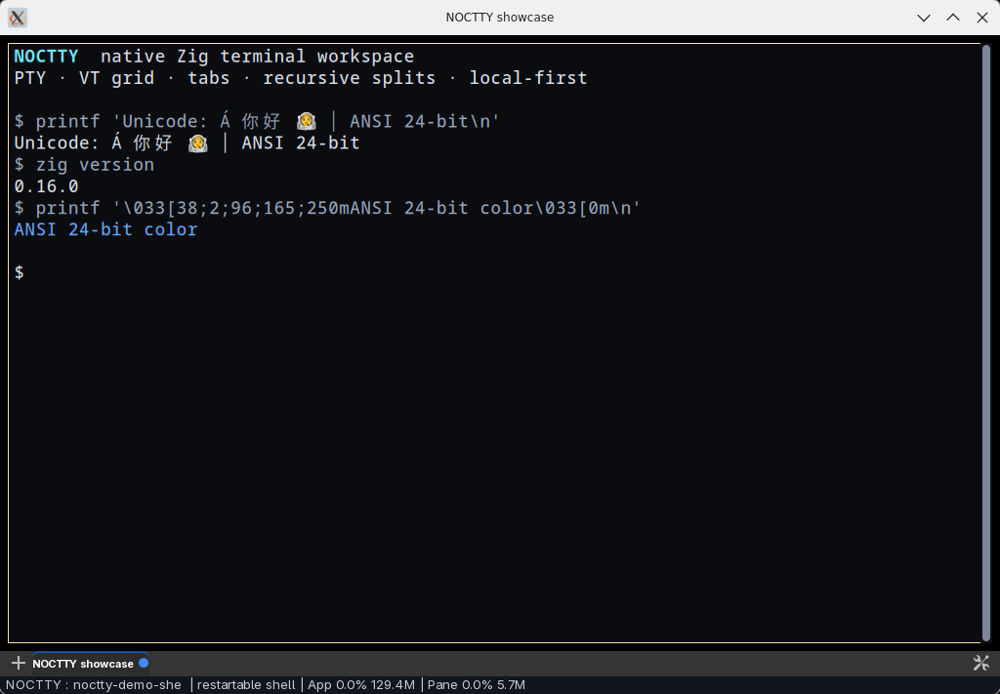
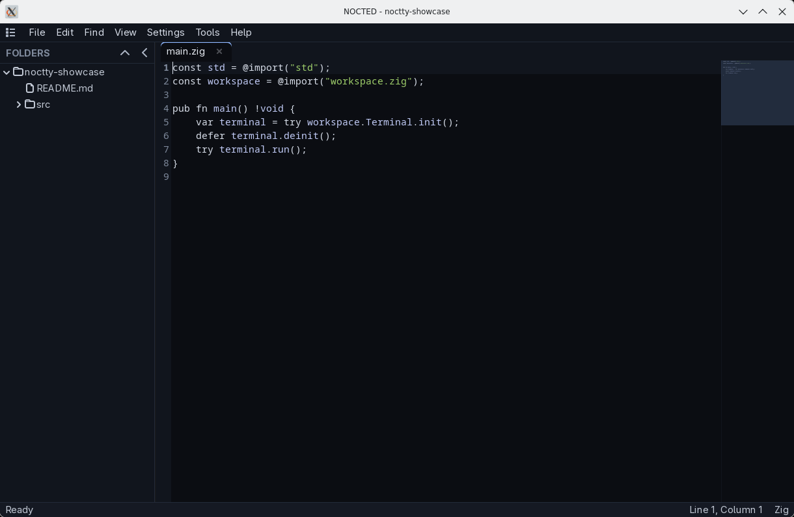

# NOCTTY

NOCTTY is a native terminal workspace focused first on Linux desktops: KDE
Plasma, Noctalia-compatible Wayland compositors, Wayland, and X11. An
experimental native Windows host now provides a first Win32/ConPTY terminal
tranche using the same Zig VT core. NOCTTY is built for the workflow that
usually turns into many heavy VS Code/MrCode/Electron windows: agent sessions,
shells, logs, quick edits, and project navigation.

NoctEd is the companion standalone editor. It is intentionally smaller than a
full IDE: open a project, edit files, search, save safely, and get back to the
terminal.

NOCTTY and NoctEd are written in Zig with thin native C ABI boundaries. The
supported runtime path does **not** use Electron, Node.js, Bun, React, a browser
UI runtime, telemetry, update pings, crash uploaders, or remote feature flags.

## Status

Current public-readiness status: **pre-public Linux alpha**.

A separate experimental Windows terminal alpha is now available for testing;
it is not yet Windows feature parity or physically qualified.

The local 0.1.0 behavior scope has substantial proof coverage on the author's
Linux/KDE-style environment, but the project is not yet a broad public release.
The next goal is to make NOCTTY/NoctEd reliable enough for daily use while
keeping the public claims small and honest.

The NCT-112 hidden/visible stability harness passes its short Debug/`ReleaseSafe`
Wayland/X11 shakedown. The default authenticated 24-hour Wayland plus 24-hour
X11 run still needs elapsed time and is not claimed complete.

Supported first:

- Linux desktop
- KDE Plasma Wayland/X11
- Noctalia-compatible Wayland sessions
- native terminal workspace use
- standalone NoctEd quick editing

Experimental:

- x86_64 Windows 10 1809+/Windows 11 single-window Win32/ConPTY terminal

Not claimed yet:

- Windows feature parity, Windows NoctEd, or physically qualified Windows
  daily-driver support
- macOS support
- VS Code/Zed/Sublime parity
- universal terminal compatibility
- multi-day production stability
- authenticated agent compatibility across every coding CLI
- signed/public packages

See [Known limitations](docs/KNOWN_LIMITATIONS.md), the [no-surprise network check](docs/NO_SURPRISE_NETWORK.md), the [code map](docs/CODE_MAP.md),
the [terminal peer research](docs/TERMINAL_PEER_RESEARCH.md), the [agent fairness qualification](docs/TERMINAL_AGENT_FAIRNESS_QUALIFICATION.md), the [mapped presentation qualification](docs/NATIVE_GRID_PRESENTATION_QUALIFICATION.md), the [full-stack mapped qualification](docs/NATIVE_GRID_FULL_STACK_QUALIFICATION.md), the [hidden/visible stability qualification](docs/NATIVE_GRID_STABILITY_QUALIFICATION.md), the [authenticated Codex qualification](docs/AUTHENTICATED_AGENT_QUALIFICATION.md), the [installed tmux/Zellij continuity qualification](docs/INSTALLED_CONTINUITY_QUALIFICATION.md), the [NoctEd native endurance qualification](docs/NOCTED_NATIVE_ENDURANCE_QUALIFICATION.md), and the detailed historical status in [Technical status](docs/TECHNICAL_STATUS.md).

## Screenshots

Current alpha screenshots from the author's Plasma Wayland desktop. Recapture
with `./scripts/capture_alpha_screenshots.sh` when the UI changes materially.





## What works today

The qualified Linux NOCTTY host provides:

- undecorated, horizontally centered dropdown mode with live percentage sizing,
  plus borderless windowed and zen/fullscreen modes
- native terminal tabs and recursive splits
- guarded broadcast input across selected panes or the active tab, with explicit enable confirmation and immediate disable
- compact tab chrome inspired by Yakuake/Konsole workflows
- bottom active-pane bar with NOCTTY-wide and selected-terminal-tree CPU/memory usage
- scrollback, search, copy/paste, mouse, resize, and Unicode/ANSI handling
- configurable launch profiles for shells, commands, SSH, tmux, and Zellij paths
- retained installed tmux 3.7b/Zellij 0.44.3 detach, NOCTTY relaunch, reattach, and preserved-content proof on Plasma Wayland/X11
- retained authenticated Codex 0.144.6 exact-response proof through the production PTY/VT/GTK/Cairo path on Plasma Wayland/X11
- hot-session workspace recovery plus mapped Wayland/X11 desktop-link and Recent Workspaces activation, with explicit shell-restart, tmux/Zellij-attach, or registered-agent-resume choices
- continuity badges distinguishing restartable shells, live sessions, and agent resumes
- opt-in password-protected encrypted screen-history export
- native settings, command palette, terminal search, Quick Note, and Project Workspace surfaces with keyboard-accessible controls, assistive names, and narrow-window scrolling
- optional tray/status notifier integration
- native themes and import paths for simple terminal color formats
- opt-in end-to-end encrypted sharing of the active terminal to one paired
  NOCTTY device, with a native remote preview and separately approved,
  connection-scoped input control

The experimental Windows host provides a native Win32/GDI window, ConPTY,
the shared Zig VT/parser, Unicode and control-key input, live resize, ANSI/true
color, scrollback, clipboard paste/visible-surface copy, local logs, local crash
dumps, and command-line LAN discovery plus paired session sharing/receiving.
It does not yet provide Linux workspace parity. See
[Windows alpha](docs/WINDOWS.md).

NoctEd provides on Linux:

- standalone `nocted` binary/process
- project tree
- a clean Untitled buffer on first launch, plus file tabs with 28-logical-pixel close targets and explicit interaction states
- UTF-8 editing through GtkSourceView with direct vendored Tree-sitter highlighting and GtkSourceView fallback
- document find and project Find in Files
- quick open
- reversible folding
- minimap
- Sublime-style `Ctrl+wheel` editor zoom
- recent projects
- atomic save/Save As behavior
- atomic hot-exit recovery for dirty saved and untitled tabs
- Save/Discard/Cancel protection when closing individual dirty tabs
- visible keyboard focus, descriptive search placeholders, and bounded 28-logical-pixel transient controls
- sustained Debug/`ReleaseSafe` Wayland/X11 search, ranking, monitor, project-lifecycle, render, memory, and teardown qualification

## Paired session sharing

Session sharing mirrors presentation state, not a PTY or process. The machine
running the shell remains authoritative; closing it ends the remote view.
Open **Session Sharing…** from the Linux workspace menu. On one device choose
**Pair: Listen**. On the other, choose **Discover on LAN** to fill the announced
endpoint, review it, and choose **Pair: Connect**. If LAN discovery is
unavailable, enter the listener's reachable hostname or IP directly. Compare
and explicitly confirm the six-digit code on both devices. The endpoint may be
a LAN address, IPv4/IPv6 address, DNS name, or a
Tailscale/WireGuard/ZeroTier-style VPN name or address.

Select the saved peer and use **Share current terminal** on the host and
**Receive selected device** on the viewer. Keep the same TCP port used during
pairing reachable on the host. Viewing is the default. Input is accepted only
after the viewer requests control and the host grants it; the grant ends on
revoke, disconnect, or reconnect. **Revoke paired device** persists locally and
closes a matching active share.

There is no relay, account service, NAT traversal, port forwarding, or subnet
scan. Pairing listeners send bounded, opt-in LAN multicast/broadcast
announcements containing only a temporary instance identifier, alias, port,
protocol version, and capability bits. Announcements are unauthenticated hints;
trust begins only after both devices confirm the same pairing code. Discovery
runs only while the user asks for it in the Session Sharing dialog; closing the
dialog stops discovery. Direct endpoints remain the reliable path across
routed VPNs.

## What NOCTTY is not

NOCTTY is not trying to be a full IDE or a VS Code clone. It is a small native
workspace for terminal-heavy development.

NoctEd is not trying to be VS Code, Zed, or Sublime Text. It should become a
trustworthy companion editor for quick project edits, not a plugin platform.

WIZP is the separate experimental rich-editor/WebView line. Ideas may transfer
from WIZP, but NOCTTY should stay native and avoid inheriting WIZP's webview,
Bun, or VS Code-parity stack.

## Build and run

Linux requirements:

- Zig 0.16.x or newer
- GTK 3 development files discoverable through `pkg-config`
- GtkSourceView 4 development files discoverable through `pkg-config`
- `gtk-layer-shell` at runtime for Wayland dropdown placement; distribution
  packages provide it, while dependency bundles and dogfood installs stage the
  pinned private runtime
- VTE 2.91 development files only for the optional legacy/fallback binary or the
  complete verification matrix

From the repository root on Linux:

```sh
./scripts/verify.sh
zig build run
```

Useful launch variants:

```sh
zig build run -- --native-grid-windowed
zig build run -- --native-grid-zen
zig build run -- --native-grid-two-pane
zig build run-nocted -- --project . --open src/nocted/main.zig
```

Optional legacy/fallback build:

```sh
zig build vte-fallback
./zig-out/bin/noctty-vte --native-host
```

Native x86_64 Windows cross-build (no GTK dependency):

```sh
zig build -Dtarget=x86_64-windows-gnu -Doptimize=ReleaseFast
./scripts/package_windows.sh dist/noctty-windows-x86_64-alpha.zip
```

See [Windows alpha](docs/WINDOWS.md) for the current feature and proof boundary.

## Install/package locally

Local install:

```sh
zig build --prefix "$HOME/.local"
```

Reproducible install-tree tarball:

```sh
./scripts/package_tarball.sh /tmp/noctty-local.tar.gz
```

Same-architecture dependency bundle:

```sh
./scripts/package_bundle.sh /tmp/noctty-linux-bundle.tar.gz
```

The dependency bundle is not a public redistribution promise until independent
license/redistribution review and release receipts are complete.

## Common controls

```text
F10                    show / hide
Ctrl+Shift+P           command palette
Ctrl+Shift+F           find in scrollback
Ctrl+Shift+N           quick note
Ctrl+Shift+Z           zoom / restore pane
Ctrl+Shift+G           Smart Tab filter
Ctrl+Shift+Y           tag selected panes
Ctrl+Shift+K           shortcut card
Ctrl+Tab               next visible pane
Ctrl+Shift+Tab         next tab / Smart Tab
Alt+Arrow              directional pane focus
Alt+wheel              previous / next pane
Ctrl+Alt+wheel         previous / next tab
Ctrl+wheel             pane font up / down
Ctrl+C                 interrupt active pane
Ctrl+D                 close active pane
Right-click pane       terminal actions / Open NoctEd Here
```

NoctEd:

```text
Ctrl+S                 save
Ctrl+F                 find in file
Ctrl+Shift+F           find in project
Ctrl+PageUp/PageDown   previous / next file
Ctrl+wheel             zoom editor text in / out
Ctrl+W                 close file
Ctrl+Shift+[/]         fold / unfold region
```

More interaction detail: [Compact UX](docs/COMPACT_UX.md).

## Verification

Fast Linux contributor gate:

```sh
zig build check
```

Windows compile gate:

```sh
zig build check -Dtarget=x86_64-windows-gnu -Doptimize=ReleaseSafe
```

The current working tree passes `zig build check -j1 --summary all` with
`19/19` steps and `343/343` tests; the single-job full verifier also passes.

Bounded public-source-alpha gate:

```sh
./scripts/public_alpha_verify.sh
```

Dogfood `ReleaseFast` install with local crash/debug logs and the private GTK
Layer Shell runtime needed for an undecorated Wayland dropdown:

```sh
./scripts/install_dogfood.sh
```

See [Dogfood install and logging](docs/DOGFOOD_LOGGING.md).

Main maintainer gate:

```sh
./scripts/verify.sh
```

A fresh current-source single-job maintainer run completed successfully on
2026-08-03, including the Debug/`ReleaseSafe` terminal, renderer, PTY, NoctEd
core/worker, project-index, package, release-contract, and truth-check lanes,
followed by `verify_cleanup scratch=true cache=true install=true artifacts=true`.

Display-backed smoke gate:

```sh
./scripts/native_release_smoke.sh
```

Opt-in focused qualification lanes exist for terminal compatibility, renderer
behavior, PTY lifecycle, NoctEd worker/index/search behavior, and native UI
lifecycle. These are engineering evidence, not blanket public guarantees. The
full detailed receipt history lives in [Technical status](docs/TECHNICAL_STATUS.md)
and the active finish list lives in [BACKLOG.md](BACKLOG.md).

## Public alpha finish line

Before publishing as a Lichforge public alpha, the project should have:

- a clean human-readable README (this file)
- current screenshots or short GIFs
- a contributor code map for navigating the large native code paths
- a minimal install/build path tested from a clean checkout
- daily-driver dogfood notes from real NOCTTY/NoctEd sessions
- known limitations documented without marketing overclaim
- package/signing/redistribution status clearly separated from source release
- a retained no-surprise network/telemetry source scan

See [Public alpha plan](docs/PUBLIC_ALPHA_PLAN.md), [go/no-go sheet](docs/PUBLIC_ALPHA_GO_NO_GO.md), [draft alpha release notes](docs/PUBLIC_ALPHA_RELEASE_NOTES.md), [Roadmap](ROADMAP.md),
[project memory](MEMORY.md), the [dogfood runbook](docs/DOGFOOD_RUNBOOK.md), the [dogfood log](docs/DOGFOOD_LOG.md), and the
historical [pitch audit](docs/PITCH_AUDIT.md). Dogfood progress can be checked with
`./scripts/dogfood_status.sh`.

## Philosophy

- Native runtime first.
- GUI-configurable behavior over required manual config editing.
- No telemetry or surprise network behavior.
- Small, proof-bounded claims.
- Prefer a dependable terminal workspace over a half-finished IDE.

## License

MIT. See [LICENSE](LICENSE).
